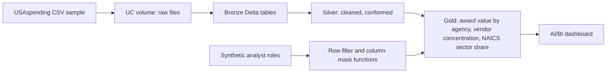
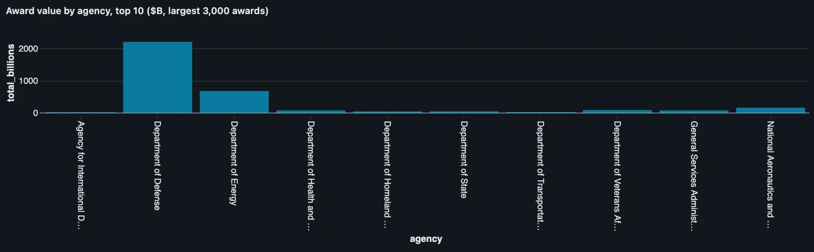
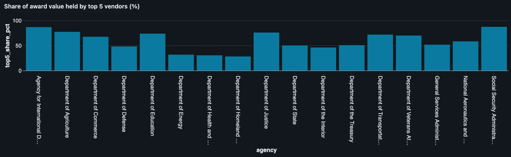
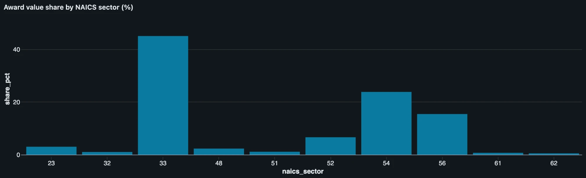
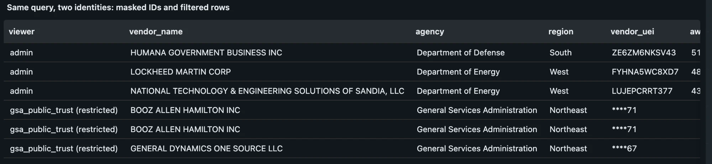

# databricks-demo

A learning project: a small, governed lakehouse for public-sector spending data, built on Databricks Free Edition.

## Honest framing

This is a hands-on learning project by Dave Contreras. It was built on Databricks Free Edition (serverless compute only, one small SQL warehouse, daily quotas). It is not production experience with Databricks at an agency, and nothing here should be read as a claim of FedRAMP, IL4/IL5, or other authorization. Items in `docs/reference-architecture.md` about extending this to a real agency are things to verify, not things I have done.

All data is public (USAspending.gov federal award data) or synthetic (the analyst roles table, labeled as such). No employer or client data is used.

## What it shows

1. Ingest raw award data into a Unity Catalog volume and bronze Delta tables.
2. Clean, conform, and aggregate into silver and gold tables with data quality checks.
3. Apply governance: grants, column masking, row filters, tags, lineage, and an audit query, with a compliance intent written next to each control.
4. Present results in an AI/BI dashboard where a restricted role sees masked and filtered data.

## Architecture



See `docs/reference-architecture.md` for data flow, controls, cost notes, and extension to a real agency.

## Setup on Free Edition

1. Create a Free Edition workspace and sign the Databricks CLI in (`docs/setup.md`).
2. Find your catalog name in the Catalog sidebar and set it as the `catalog` widget or variable at the top of each notebook.
3. Create the volume and upload `data/sample/*.csv` to it: `databricks schemas create bronze <catalog>`, `databricks volumes create <catalog> bronze raw_files MANAGED`, then `databricks fs cp data/sample/<file> dbfs:/Volumes/<catalog>/bronze/raw_files/`.
4. Run notebooks 01 to 04 in order, in the workspace or with `scripts/run_notebook.sh 01_ingest_bronze` (set `DATABRICKS_BIN` if the CLI is not on PATH).

## Results






How to read these: the sample is the 3,000 largest FY2025 contract awards by total award value, not a random sample. Amounts are total award value (including multi-year ceilings), not annual spending, so agency totals and vendor concentration are skewed toward large awards and should not be read as real agency spending. They exist to exercise the pipeline and governance controls.

## Folder map

```
README.md
docs/                  setup, reference architecture, talk track
data/sample/           small public CSV samples and the synthetic roles table
notebooks/             01 to 04 Databricks source files
scripts/               data download helpers
tests/                 local checks that run without Databricks
```

## Status

Module A: notebooks 01 to 04, talk track, and reference architecture are written. Screenshots (docs/img) are still to capture. Later modules (agent, GTM kit) are out of scope for this repo state.
