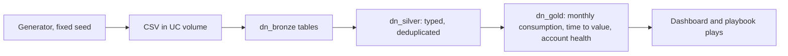

# Digital natives program kit

A learning project for the Digital Natives side of a go-to-market role: how to turn consumption data into a program for fast-growing, cloud-native companies. Built on Databricks Free Edition, as a companion to the governed lakehouse in the parent folder.

## Honest framing

- All data is SYNTHETIC. The 40 accounts are fictional (names end in "Demo") and generated by `scripts/generate_telemetry.py` from a fixed random seed. Nothing here says how real customers behave.
- The health score weights, status thresholds, and illustrative price per compute unit are my assumptions, not fitted to real outcomes.
- I have not run a Databricks GTM program. The playbook is how I would approach it, with the things I would validate listed at the end.

## What is in the kit

| Piece | File |
|---|---|
| Synthetic telemetry generator | `scripts/generate_telemetry.py`, output in `data/sample/` |
| Ingest, transform, analytics notebooks | `notebooks/01` to `03` |
| Dashboard (created via CLI) | `scripts/create_dashboard.py` |
| Program playbook | `docs/program-playbook.md` |
| Talk track | `docs/talk-track.md` |
| Local tests | `tests/` |

## Two segments

The 40 accounts split into 20 AI-native startups (heavy on ML and AI workloads) and 20 data-heavy SaaS companies (heavy on SQL and jobs). Each account follows a hidden pattern (fast ramp, steady grower, plateau, churn risk, late bloomer) that the analytics must find without being told.

## Data flow



## Run it

From the repo root, with the Databricks CLI signed in (see `docs/setup.md`):

```bash
python3 digital-natives-kit/scripts/generate_telemetry.py   # optional, sample data is committed
databricks schemas create dn_bronze <catalog>
databricks volumes create <catalog> dn_bronze raw_files MANAGED
for f in digital-natives-kit/data/sample/*.csv; do databricks fs cp $f dbfs:/Volumes/<catalog>/dn_bronze/raw_files/ --overwrite; done
digital-natives-kit/scripts/run_notebook.sh 01_ingest_bronze
digital-natives-kit/scripts/run_notebook.sh 02_transform_silver_gold
digital-natives-kit/scripts/run_notebook.sh 03_analytics_checks
python3 digital-natives-kit/scripts/create_dashboard.py <catalog> <warehouse_id>
python3 -m unittest discover digital-natives-kit/tests
```

## Check against the hidden patterns

Notebook 03 compares each account's computed status with the generator's hidden pattern. On the committed data: all 7 churn-risk accounts are flagged at risk, all 4 late bloomers are flagged as expansion candidates, all 8 plateau accounts land on watch, and 8 of 10 fast ramp accounts are healthy. This shows the scoring logic behaves as designed. It is not evidence that it predicts real churn.
