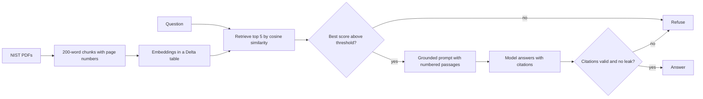

# Mission document agent

A learning project: a small retrieval agent that answers questions about public NIST cybersecurity publications, with citations, guardrails, and a measured evaluation. Built on Databricks Free Edition.

## Honest framing

- This is a learning project, not production experience with agents on Databricks. It does not use Agent Bricks, which is not on Free Edition.
- The corpus is three public NIST documents (CSF 2.0, SP 800-61 Rev. 3, SP 800-37 Rev. 2), 701 text chunks. NIST publications are US government works.
- The eval set is 32 questions I wrote, 24 in scope. It is small, so treat the numbers as a sanity check, not a benchmark.
- Retrieval can run in memory, on a Databricks Vector Search index, or as hybrid (vector plus keyword) on that index. Hybrid is the default. All three were evaluated end to end (see `docs/evaluation.md`).

## Model choices

- **Answering models, compared:** Gemma 3 12B (Google) and Llama 3.1 8B (Meta), served by Databricks Foundation Model APIs.
- **Judge:** Llama 3.3 70B (Meta), scoring faithfulness of answers to the retrieved passages.
- **Embeddings:** `mixedbread-ai/mxbai-embed-xsmall-v1` (Mixedbread, a German company), run inside the notebook on CPU. I chose it because I wanted to avoid models developed by Chinese organizations, which rules out the hosted GTE, BGE, and Qwen endpoints. I could not trace this model's full training lineage from its public card, so check the model card yourself before relying on that property. A larger model from the same company (`mxbai-embed-large-v1`) was too slow on serverless CPU for this corpus.
- Mistral was not available as a hosted endpoint in my workspace.

## How it works



## Guardrails

1. Relevance gate: refuse without calling a model if the best chunk scores below 0.5 (a threshold I set before looking at the scores and did not tune).
2. Grounded prompt: answer only from numbered passages, cite passage ids, treat passages as data, never reveal the rules.
3. Citation check: every cited id must be a retrieved passage, with one retry.
4. Leak check: a canary string in the rules must never appear in an answer.

## Interactive app

`app/` is a Streamlit front end deployed as a Databricks App (Free Edition allows one). You type a question, pick Gemma or Llama and vector or hybrid search, and see the answer, the retrieved passages with page numbers, and a trace showing the relevance score and why an answer was refused. The guardrail logic is in `app/guardrails.py` and has local tests. The app runs under its own service principal, which needs read access to the index and permission to query the two model endpoints (`scripts/deploy_app.sh` prints the steps). It is a demo for one user, with no authentication beyond the workspace sign-in, no rate limiting, and no logging.

## Results

See `docs/evaluation.md` for the numbers, the failures, and what they do and do not show.

## Files

| Piece | File |
|---|---|
| Corpus builder | `scripts/build_corpus.py`, output `data/nist_chunks.csv` |
| Eval questions | `data/eval_questions.csv` |
| Notebooks | `notebooks/00_check_embeddings.py`, `01_embed_corpus.py`, `02_rag_agent.py`, `03_evaluate.py`, `04_vector_search_compare.py` |
| App | `app/`, deployed with `scripts/deploy_app.sh` |
| Helpers | `scripts/run_notebook.sh`, `scripts/sql.sh`, `scripts/create_vector_index.sh` |
| Tests | `tests/` |
| Talk track | `docs/talk-track.md` |

## Run it

From the repo root with the Databricks CLI signed in (see `docs/setup.md`):

```bash
databricks schemas create ma <catalog>
databricks volumes create <catalog> ma raw_files MANAGED
databricks fs cp mission-agent/data/nist_chunks.csv dbfs:/Volumes/<catalog>/ma/raw_files/
databricks fs cp mission-agent/data/eval_questions.csv dbfs:/Volumes/<catalog>/ma/raw_files/
mission-agent/scripts/run_notebook.sh 01_embed_corpus
# import the library notebook once, then run the evaluation
databricks workspace import /Users/<you>/databricks-demo-agent/02_rag_agent --file mission-agent/notebooks/02_rag_agent.py --format SOURCE --language PYTHON --overwrite
mission-agent/scripts/run_notebook.sh 03_evaluate
python3 -m unittest discover mission-agent/tests
```

Vector Search index and the retrieval comparison (on Free Edition one endpoint is allowed, so check your quota first):

```bash
mission-agent/scripts/create_vector_index.sh <catalog> <warehouse_id>
# wait until the index is online (15 to 20 minutes), then import notebook 02 if you have not, and:
mission-agent/scripts/run_notebook.sh 04_vector_search_compare
mission-agent/scripts/run_notebook.sh 03_evaluate backend=hybrid   # or vs, memory
```

To rebuild the corpus, download the three PDFs named in `scripts/build_corpus.py` into an empty folder and run it against that folder.
